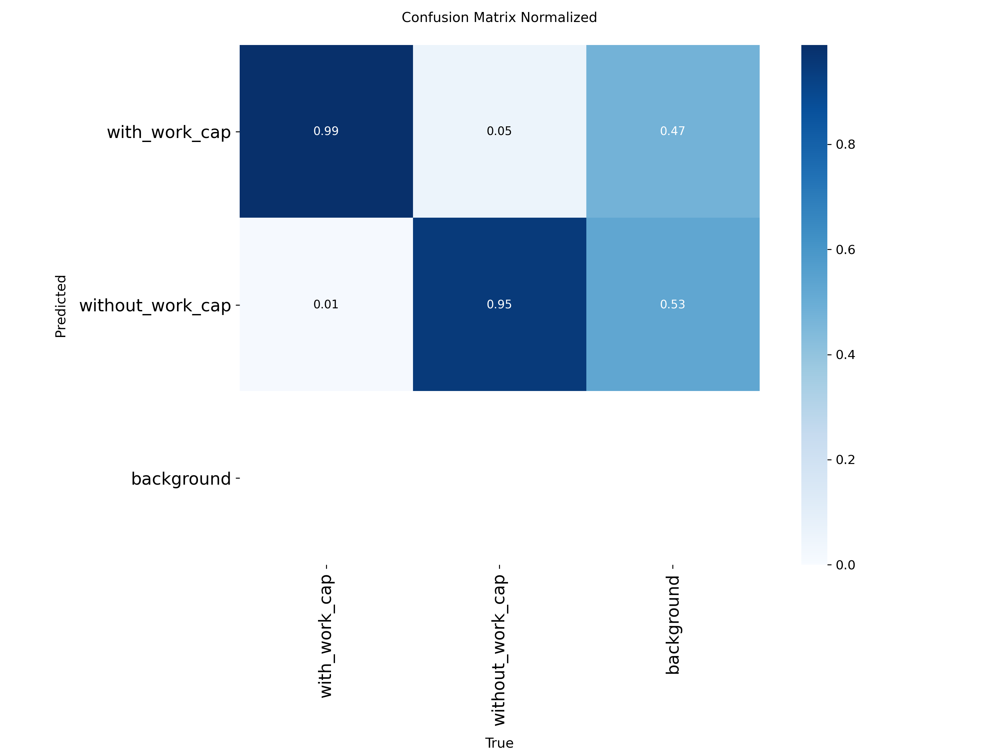
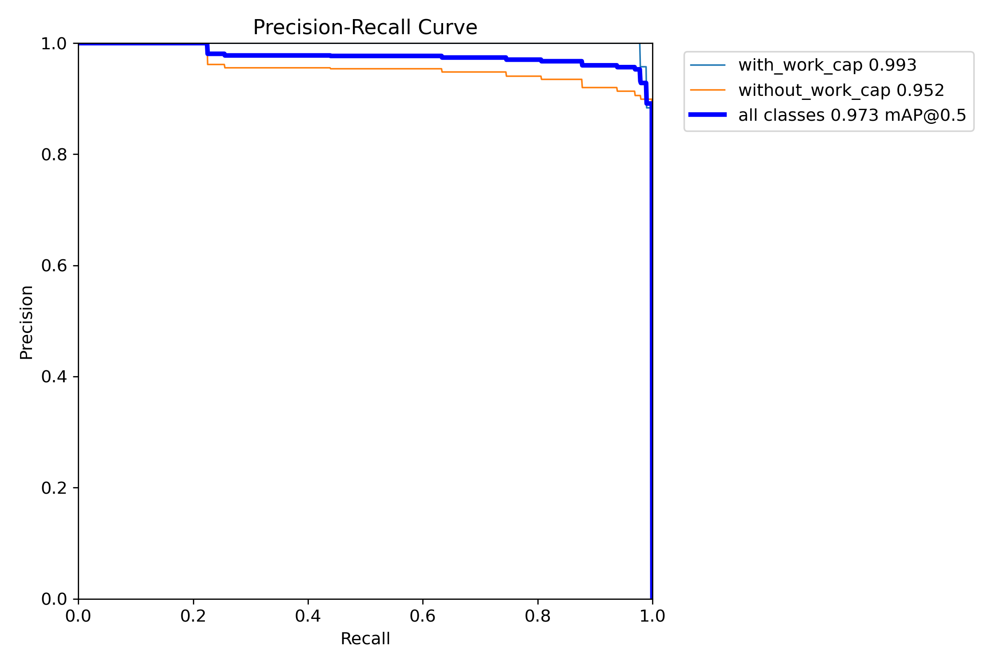
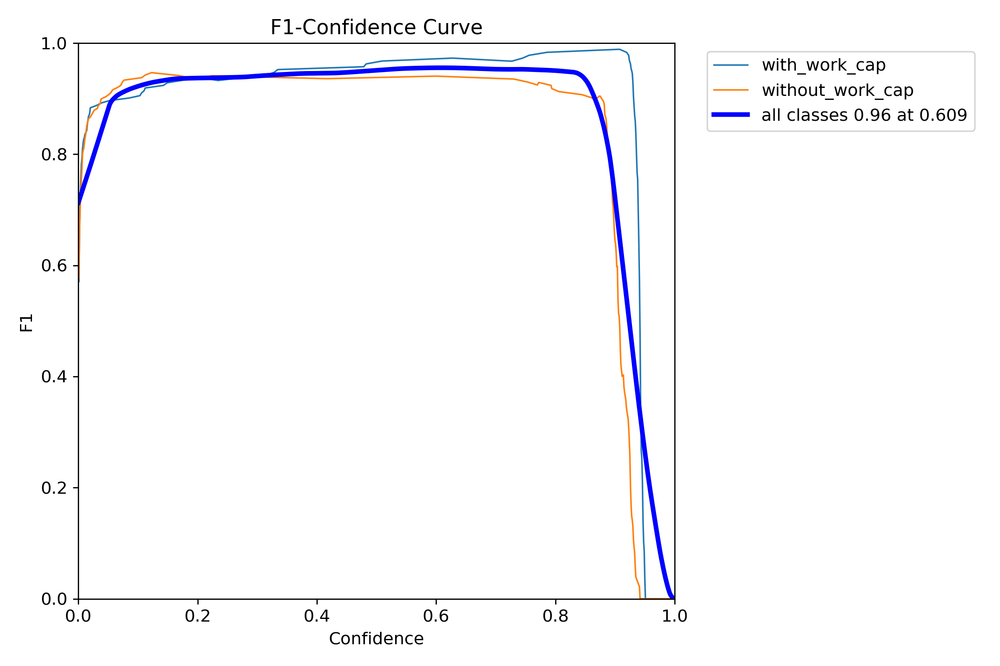
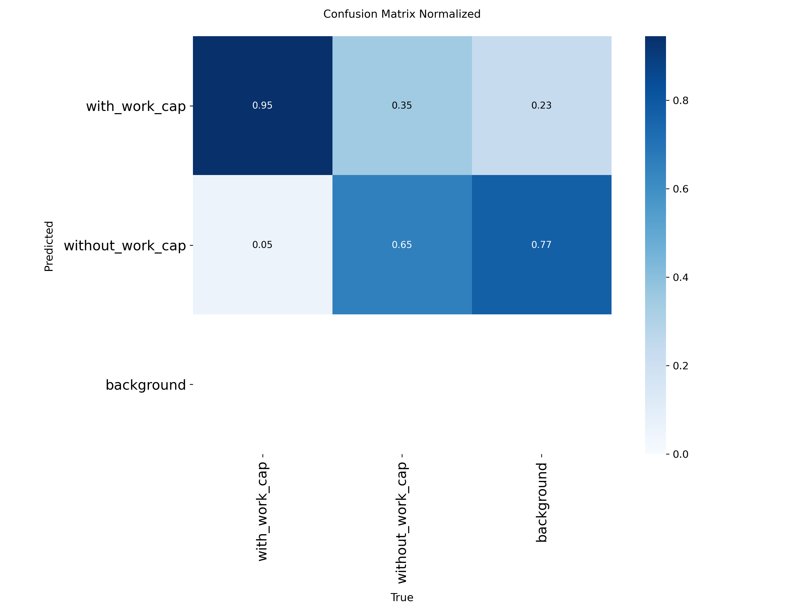
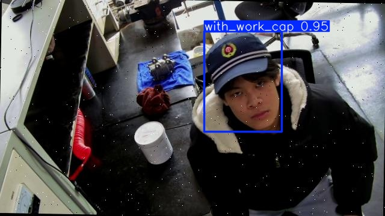
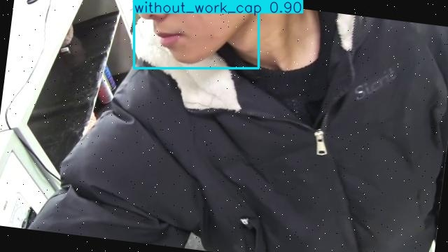

# 任务二：工作帽佩戴状态检测 —— 实验报告

> 数据集：Roboflow *helmet* v3（CC BY 4.0，2384 张 640×360）
> 模型：YOLO11n（ultralytics 8.4.174 / torch 2.8.0+cu129 / RTX 4070 Laptop 8GB）
> 全部结果由 `code/scripts/` 下脚本生成，指标文件：`code/report/metrics.csv`、`compare_table.csv`、`threshold_sweep.csv`

## 1. 任务要求与完成情况

| # | 任务要求 | 完成情况 | 产物 |
|---|---|---|---|
| 1 | 至少区分「佩戴 / 未佩戴工作帽」两种状态 | 2 类：`with_work_cap`、`without_work_cap` | `dataset/helmet/data.yaml` |
| 2 | 整理、清洗并标注样本，生成 YOLO 数据集配置 | 合并离线增强副本、剔除跨集合近重复、类别重映射 | `scripts/prepare_dataset.py`、`dataset/helmet/qc.json` |
| 3 | 使用 YOLO11n/11s 建立基线，训练并保存 best.pt | YOLO11n 100 epochs，`best.pt` + `config.json` | `code/weights/baseline_yolo11n_best.pt` |
| 4 | 统计 Precision / Recall / mAP@0.5 / mAP@0.5:0.95，保存混淆矩阵 | val + test 每类指标、混淆矩阵、PR/F1 曲线 | `report/metrics.csv`、`report/assets/` |
| 5 | 至少 1 组对比实验并用表格比较 | 默认增强 vs 强增强（100 epochs，其余相同） | `report/compare_table.md` |
| 6 | 图片与视频推理，显示类别+置信度并保存结果 | 目录/单图/视频推理，保存结果图/视频与 CSV | `scripts/predict.py`、`code/outputs/` |
| 7 | 训练/验证/测试相互独立，测试集不参与训练调参 | 按视频族+帧序时间块划分，跨集合近重复已剔除 | 本报告 §2.3 |

## 2. 数据集

### 2.1 来源与类别定义

- 原始数据：`data/考核任务数据/安全帽（无test）数据`（train 2190 张 / valid 194 张，原类别 `hat`、`head`，**无 test 划分**）。
- 类别重映射：`hat → with_work_cap (0)`，`head → without_work_cap (1)`；标签中的类别 id 本身保持 0/1，无需改动坐标。
- 检测框口径：两类框标注的都是**头部区域**（含帽子），未使用「人员上半身」口径，全库未混用。
  原标签统计：`hat` 框平均高 0.462、`head` 框平均高 0.388（归一化高度），宽高比 0.44 / 0.62，均落在头部范围。
- 数据中 94 张为无标注背景图（重建后保留 68 张），作为负样本使用，不参与 mAP 统计但影响 Precision。

### 2.2 清洗

Roboflow 导出时对每张源帧做了 3 份离线增强（旋转 ±8°、亮度 ±8%、高斯模糊、椒盐噪声），造成同一帧的近似副本。处理规则：

1. 同一文件族（`.rf.` 之前部分）内，类别相同、框坐标差 ≤ 0.02、灰度 NCC ≥ 0.90 视为同一源帧，仅保留 1 张：**2384 → 1848 张，合并副本 536 张**。
2. 划分完成后，剔除与其它集合中同类别帧 NCC ≥ 0.99 且框差 ≤ 0.02 的帧：**再剔除 125 张**，最终 **1723 张**。

| 集合 | 图片数 | with_work_cap | without_work_cap | 无标注背景 |
|---|---|---|---|---|
| train | 1323 | 557 | 725 | 41 |
| val | 191 | 92 | 92 | 7 |
| test | 209 | 91 | 98 | 20 |
| 合计 | 1723 | 740 | 915 | 68 |

### 2.3 独立划分与校验

- 划分单位是「视频族 + 帧序号」：同一源帧的所有副本、以及同名不同内容的帧永远落在同一集合。
- 每个视频族内按帧序 **时间块 70% / 15% / 15%** 切分（不随机打散），并用确定性哈希兜底处理无帧序的单张图（seed=42）。
- 校验结果（`prepare_dataset.py` 自动输出，见 `dataset/helmet/qc.json`）：

| 校验项 | 结果 |
|---|---|
| 跨集合完全相同文件（MD5） | 0 |
| 跨集合近重复帧（NCC ≥ 0.99 且框差 ≤ 0.02） | 0（剔除了 125 张后） |
| 跨集合同类帧相似度中位数 / p99 | train-val 0.518 / 0.934；train-test 0.410 / 0.927 |
| 标签越界、类别非法、缺失标签 | 0 |
| test 是否参与训练或调参 | 否（仅用于最终评估与推理演示） |

- 说明：残留 11 对跨集合高相似帧全部是**无标注背景帧**（无目标），不影响检测指标，作为真实负样本保留。

### 2.4 原训练结果为何不可用

原 `runs/detect/train-2`（100 epochs）报告 val mAP@0.5 = 0.995，但该划分并不独立：原 valid 的 194 张中，**167 张能在 train 中找到同类且灰度 NCC ≥ 0.95 的帧，126 张 NCC ≥ 0.99**（同一段视频相隔 5 帧的相邻画面）。即验证集与训练集几乎是同一批画面，0.995 只是「记住场景」，不能反映真实性能。本报告全部结论基于重建后的独立划分。

## 3. 训练设置

| 项 | 基线 | 对比组 |
|---|---|---|
| 模型 | yolo11n.pt（COCO 预训练） | 同左 |
| epochs | 100 | 100 |
| batch | 16 | 16 |
| imgsz | 640 | 640 |
| optimizer / lr0 / lrf | auto / 0.001667 / 0.01 | 同左 |
| momentum / weight_decay | 0.937 / 0.0005 | 同左 |
| warmup_epochs | 3.0 | 3.0 |
| 增强 | ultralytics 默认（mosaic 1.0、scale 0.5、translate 0.1、fliplr 0.5、hsv 0.015/0.7/0.4） | 强增强（见下） |
| seed / deterministic | 0 / true | 同左 |
| patience | 40 | 40 |
| 参数量 / GFLOPs | 2,590,230 / 6.5 | 同左 |
| 训练耗时 | 24.2 min | 29.1 min |
| 环境 | Python 3.9.23、torch 2.8.0+cu129、ultralytics 8.4.174、RTX 4070 Laptop 8GB | 同左 |

强增强参数：`hsv_h=0.03, hsv_s=0.9, hsv_v=0.5, degrees=10, translate=0.2, scale=0.7, shear=2, perspective=0.0005, mixup=0.15, erasing=0.5`，其余与基线一致。

完整超参与版本信息记录在 `code/runs/<run>/config.json`，训练曲线在 `code/runs/<run>/results.png`。

## 4. 评估结果

### 4.1 val / test 指标（基线，默认增强）

| split | class | Images | Instances | Precision | Recall | mAP@0.5 | mAP@0.5:0.95 |
|---|---|---|---|---|---|---|---|
| val | with_work_cap | 191 | 92 | 0.9976 | 1.0 | 0.9950 | 0.9640 |
| val | without_work_cap | 191 | 92 | 1.0 | 0.9862 | 0.9948 | 0.8891 |
| val | all | 191 | 184 | 0.9988 | 0.9931 | 0.9949 | 0.9266 |
| test | with_work_cap | 209 | 91 | 0.9558 | 0.9890 | 0.9934 | 0.9277 |
| test | without_work_cap | 209 | 98 | 0.9134 | 0.9687 | 0.9524 | 0.6791 |
| test | all | 209 | 189 | 0.9346 | 0.9788 | 0.9729 | 0.8034 |

- 两类在 mAP@0.5 上都在 0.95 以上，说明「戴/不戴」的判别非常可靠。
- 差距体现在 mAP@0.5:0.95：`without_work_cap` 只有 0.679，明显低于 `with_work_cap` 的 0.928。原因是未戴帽样本的标注框更紧（部分只框住面部/半张脸），高 IoU 阈值下框贴合要求更苛刻；实际使用 conf=0.4~0.5 时 Recall 仍有 0.97+，不影响状态判定。

### 4.2 混淆矩阵与曲线（test 集）







原始混淆矩阵：`assets/baseline/test/confusion_matrix.png`；预测示例：`assets/baseline/test/val_batch0_pred.jpg`。

### 4.3 置信度阈值扫描（test 集）

| run | conf | Precision | Recall | F1 |
|---|---|---|---|---|
| baseline | 0.25 | 0.8959 | 0.9836 | 0.9376 |
| baseline | 0.40 | 0.9138 | 0.9796 | 0.9455 |
| baseline | 0.50 | 0.9263 | 0.9792 | 0.9520 |
| baseline | 0.60 | 0.9343 | 0.9792 | 0.9562 |
| strongaug | 0.25 | 0.9173 | 0.9694 | 0.9424 |
| strongaug | 0.40 | 0.9440 | 0.9694 | 0.9565 |
| strongaug | 0.50 | 0.9506 | 0.9694 | 0.9599 |
| strongaug | 0.60 | 0.9614 | 0.9592 | 0.9603 |

阈值为 0.5 时基线 Precision 提升约 3.0 个百分点（0.896 → 0.926），Recall 仅下降约 0.4 个百分点（0.984 → 0.979），工程部署建议 `conf=0.5`；强增强模型在 0.6 处 F1 最高（0.9603）。

## 5. 对比实验：默认增强 vs 强增强

| 模型 | 增强 | split | P | R | mAP@0.5 | mAP@0.5:0.95 | 训练耗时(min) |
|---|---|---|---|---|---|---|---|
| yolo11n.pt | 默认 | val | 0.9988 | 0.9931 | 0.9949 | **0.9266** | 24.2 |
| yolo11n.pt | 强增强 | val | 0.9902 | 1.0000 | 0.9949 | 0.8945 | 29.1 |
| yolo11n.pt | 默认 | test | 0.9346 | **0.9788** | **0.9729** | **0.8034** | 24.2 |
| yolo11n.pt | 强增强 | test | **0.9542** | 0.9694 | 0.9713 | 0.7889 | 29.1 |

> 两组为同一网络结构，推理速度差异（约 2.5 ~ 4.4 ms/图，受测量时 GPU 负载影响）不代表模型差异。

分析：



1. 两组 mAP@0.5 都稳定在 0.971~0.973，差异 0.0016 属于单次训练的波动量级；**强增强没有带来实质提升**。
2. 强增强把 test Precision 提高了 2.0 个百分点（0.9346 → 0.9542），但 Recall 下降 0.9 个百分点、mAP@0.5:0.95 下降 0.0145，val 上 mAP@0.5:0.95 下降 0.0321。
3. 训练耗时增加 20%（24.2 → 29.1 min）。
4. 原因判断：本数据集只有 3 段接近静止的场景、1323 张训练图，场景多样性极低；强增强（大角度旋转、mixup、透视、剪切）引入的分布偏移大于它带来的泛化收益，模型反而在框定位上更保守。若后续数据扩展到多场景、多光照，强增强的价值才可能体现。
5. 结论：**默认增强为最终方案**，`baseline_yolo11n_best.pt` 作为交付权重。

## 6. 推理程序

`code/scripts/predict.py` 支持单图、图片目录、视频文件三种输入，输出：

```
code/outputs/<source>/
  images/            # 带框 + 类别 + 置信度的结果图
  video/<name>_pred.mp4   # 带框 + 类别 + 置信度的结果视频
  detections.csv     # 每条检测：source, frame, class, confidence, x1,y1,x2,y2
  summary.csv        # 逐图/逐帧统计与状态判定（wearing / not_wearing / mixed / no_detection）
```

```powershell
# 图片目录
& $py code\scripts\predict.py --weights d:/hat/code/weights/baseline_yolo11n_best.pt `
    --source d:/hat/dataset/helmet/images/test --conf 0.5

# 视频
& $py code\scripts\predict.py --weights d:/hat/code/weights/baseline_yolo11n_best.pt `
    --source d:/hat/code/outputs/demo/test_clip.mp4 --conf 0.5
```

示例结果（test 集 209 张图，`conf=0.5`）：





- test 集 209 张（`conf=0.5`）：检出 `with_work_cap` 97 个、`without_work_cap` 104 个，标注为 91 / 98，数量基本一致（差额来自背景帧上的少量误检）。
- 演示视频（由 test 图片按帧序合成，20 s @ 8 fps）：160 帧全部处理完成，检出 `with_work_cap` 85 个、`without_work_cap` 71 个，结果视频 `code/outputs/demo_baseline/video/test_clip_pred.mp4`。
- 单帧状态判定逻辑：只检出 `with_work_cap` → `wearing`；只检出 `without_work_cap` → `not_wearing`；两者都有 → `mixed`；无检测 → `no_detection`。

## 7. 局限与后续改进

1. **数据规模与多样性不足**：3 段近静止视频、单一工位、640×360 低分辨率，且人员/服装高度相似，因此 val/test 指标（mAP@0.5 ≈ 0.97）偏乐观。真实产线需要补充多场景、多光照、多姿态、遮挡与多人场景数据。
2. **未做跨场景测试**：数据中不同场景的样本量不足以同时支撑训练与跨场景评估；扩充数据后建议增加「留一场景」测试集。
3. **框口径**：`without_work_cap` 的部分框过紧（只框面部），建议统一为「整个头部」重新复核标注，可显著提升 mAP@0.5:0.95。
4. **对比实验维度**：本次按需求完成「数据增强」一组；数据扩充后可再补模型规模（11n/11s）与输入尺寸（640/960）对比。
5. 背景图（68 张）会稀释精确率统计，报告中已单独说明。

## 8. 复现步骤

完整命令见 `code/README.md`，核心 6 步：

```powershell
$py = 'd:\miniconda3\envs\pytorch\python.exe'
& $py code\scripts\prepare_dataset.py
& $py code\scripts\train.py --name baseline_yolo11n
& $py code\scripts\train.py --name strongaug_yolo11n --aug strong
& $py code\scripts\evaluate.py --run baseline=d:/hat/code/weights/baseline_yolo11n_best.pt --run strongaug=d:/hat/code/weights/strongaug_yolo11n_best.pt
& $py code\scripts\make_report_tables.py
& $py code\scripts\make_demo_video.py
```

注意：`prepare_dataset.py` 会重建 `dataset/helmet`，重建后再训练才能保证与本报告数字一致；`evaluate.py` 只读取 test，不会反向影响训练。

## 附录：产物清单

| 产物 | 路径 |
|---|---|
| 数据集（1723 张，YOLO 格式） | `dataset/helmet/` |
| 数据配置 | `dataset/helmet/data.yaml` |
| 划分清单 / QC | `dataset/helmet/split_manifest.csv`、`qc.json` |
| 最终权重 | `code/weights/baseline_yolo11n_best.pt`（对比组：`strongaug_yolo11n_best.pt`） |
| 训练配置与曲线 | `code/runs/<run>/config.json`、`results.png`、`args.yaml` |
| 指标 | `code/report/metrics.csv`、`metrics_table.md`、`threshold_sweep.csv` |
| 对比表 | `code/report/compare_table.md`、`compare_table.csv` |
| 图表 | `code/report/assets/<run>/<split>/` |
| 推理结果 | `code/outputs/test/`、`code/outputs/demo_baseline/` |
| 历史记录（不参与结论） | `code/runs/detect/train*`、`code/yolo11.ipynb` |
